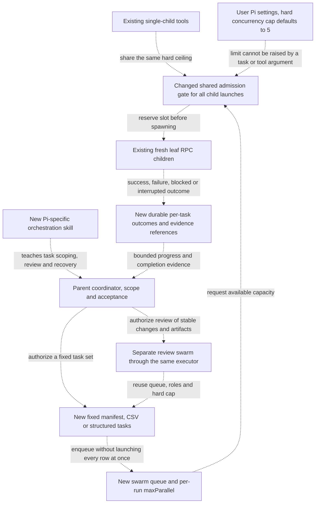

# Generic subagent swarms — agreed implementation specification

Extend the existing custom subagent extension with a generic executor for N independently scoped tasks, bounded by a user-configured concurrency ceiling. Recommend a separate review swarm using the same executor; do not add an automatic work/review/repair engine. Deliver a companion skill teaching effective orchestration.

Target implementation: `C:/Users/johan/.pi/agent/extensions/simple-subagents/`. This document is the handoff, not an instruction to change any application repository. Read the target repository's instructions, current extension and goal-loop contracts, and the installed Pi SDK/extensions/settings/skills documentation before implementation. If evidence contradicts this design, stop with a recommendation rather than silently deviating. The user confirmed the scope and proposed details in the implementation conversation. The only subsequent change is the Pi-specific companion-skill location below.

## Design



The extension owns execution and attempt facts. The parent owns decomposition, review tasks and acceptance. All edges describe the upgraded design, not existing guarantees.

## Decisions

- **Agreed:** permanent generic executor; CSV is an input adapter, not domain-specific scheduling logic. Structured tasks use the same execution path.
- **Agreed:** independent review is a separate swarm; fresh leaf agents do not delegate recursively. The parent decides whether review or bounded repair is needed.
- **Agreed:** an extension-enforced concurrency ceiling, default **5**, configurable in personal Pi settings. Per-swarm `maxParallel` may request less capacity, never bypass the ceiling.
- **Agreed — Ceiling scope:** one Pi process/extension instance, across all swarms, direct children and reviewer roles. It is not a machine-wide semaphore across separately launched Pi processes. Reserve/release capacity atomically so concurrent tool calls cannot oversubscribe it; starting and unconfirmed-stopping children occupy slots.
- **Agreed — Configuration:** user/agent-directory `settings.json` key `simpleSubagents.maxConcurrency`. Project settings, CSV contents and tool arguments cannot raise it. Read it at startup/reload. Missing means 5; a malformed/non-positive/non-integer value refuses launches with a clear diagnostic, rather than silently disabling the limit. Do not modify unrelated settings.
- **Agreed — Attempts:** one attempt per manifest item. Failed items do not stop unrelated items; retries/repairs are explicitly submitted new tasks, not implicit loops. Keep existing per-child deadline bounds. Swarms can exceed twenty total tasks; the old lifetime-start counter must not truncate an admitted manifest.
- **Agreed — Persistence:** store the immutable manifest and incremental outcomes in an extension-owned run store under the agent directory. Pin cwd, input records and shared instruction at creation. Preserve evidence across reload/fresh sessions, but never persist armed authorization or keep detached children alive.
- **Agreed — Scope:** writable ownership is part of the task instructions and companion skill, not a new OS sandbox. Retain explicit role/tool restrictions. Do not add automatic worktree creation, commits or merge automation.

Configuration example, merged into the user's settings rather than replacing that file:

```json
{
  "simpleSubagents": {
    "maxConcurrency": 5
  }
}
```

`pi.getSettings()` returns merged project/user settings, so using its effective value alone must not let a project raise this user-level ceiling. Resolve the user-authoritative value through the supported settings API or narrowly read the relevant agent-directory setting; do not log other settings or credentials.

## Contracts

These tool names/input shapes freeze the agreed public surface. Preserve existing single-child start/status/steer/stop tools and their role/context/approval behavior; they share the new ceiling.

```typescript
type SwarmTask = { id: string; task: string };
type SwarmSource =
  | { tasks: SwarmTask[]; csvPath?: never }
  | { csvPath: string; tasks?: never };

swarm_start({
  ...source,                 // exactly one SwarmSource
  agent,                    // existing role profile
  instruction?,             // shared context/instruction, required for CSV
  maxParallel?,             // positive integer, defaults to configured ceiling
  timeoutSeconds?           // existing child bounds, measured from dispatch
}) -> { swarmId, taskCount, requestedParallelism, effectiveParallelism };

swarm_status({ id }) -> bounded run summary, counts, effective limit and attention items;
swarm_results({ id, offset?, limit? }) -> bounded page of per-task outcomes and evidence references;
swarm_pause({ id });
swarm_resume({ id });
swarm_stop({ id });
```

- Check the complete manifest before launching children: nonempty tasks, unique structured-task IDs, valid role/limits and existing task-size bounds. A request above the configured ceiling is accepted at the ceiling and reports the effective value explicitly; it does not launch extra children.
- Parse CSV with correct headers, quoting, commas, multiline fields, UTF-8 and optional BOM handling. Keep cell values as strings. Reject duplicate/empty headers and malformed records before dispatch. Ignore wholly empty records. Assign stable internal row IDs and preserve every named column, including a business-data column named `id`; do not assume it is a unique executor ID.
- Each child receives the shared instruction plus exactly its own task/complete row, with ordinary inherited instructions and role context. CSV records are data, not authorization or hidden configuration. The parent conversation is not copied implicitly.
- Start returns promptly with a durable ID. The extension dispatches queued items as capacity becomes available without a parent-model turn per item. Keep pending work distinct from active processes, and pending tasks visible when a queue is waiting for capacity.
- Each outcome identifies swarm/task/attempt, source row if applicable, child ID, state/timestamps, bounded answer/error, reported artifacts/check evidence and available usage. Truncation is explicit. Reported evidence is not an independent correctness proof. The executor does not invent an `accepted` verdict from normal child exit or claim an exact monetary ceiling from incomplete pricing.
- **Pause** stops further admission and lets active attempts finish. **Stop** stops admission, cancels queued items and requests termination of active children; unconfirmed teardown remains visible, retains capacity and blocks further admission as today until explicitly reconciled. **Resume** explicitly reauthorizes only never-started items from the recorded manifest in the pinned workspace. Interrupted/failed/cancelled attempts are not silently replayed.
- Reload/session teardown stops children and admission as today; incomplete attempts become interrupted or unconfirmed, not successful. Reading old results cannot restart work. Reject late/foreign/duplicate delivery as authority to launch more work.
- Keep the parent informed through the existing widget and a coalesced completion/needs-input follow-up, not one model wake per row. Results remain retrievable even if notification dispatch is unacknowledged. Partial progress is inspectable without polling; normal scheduling does not depend on the parent reading status.

### Goal-loop compatibility

Register swarm ownership before dispatch. A waiting round owns the complete queued/active run, not only the currently spawned children. Preserve exact session/loop identity and acknowledgement on parent consumption: child exit, queued follow-up and run completion are distinct events.

Continue dispatching only within the fixed batch's valid authorization and original loop limits. `/loop stop`, loop expiry or parent abort stops further swarm admission without automatically killing already running children; explicit swarm stop handles cancellation. Queued work must not become standalone-authorized merely because its owning loop stopped. Resume needs explicit authorization; no queued work may approve a new manual round, refresh deadlines or revive a stopped loop. Adapt the shared contract and regression tests together rather than bypassing it.

## Companion skill

Deliver **`subagent-orchestration`**, discoverable through normal skill loading. use Pi's natively discovered personal skills location at `C:/Users/johan/.pi/agent/skills/subagent-orchestration/SKILL.md`; do not create duplicate copies in multiple discovery paths. Follow the `skill-authoring` skill. Its routing description should trigger on parallel delegation, CSV/task swarms, separate review swarms and recovery of interrupted delegated batches.

The skill teaches judgment and expected usage, while tool descriptions retain only concise execution invariants:

- Choose single delegation versus a swarm; identify independent tasks before parallelizing. Keep shared-contract/integration ownership with the parent.
- Prepare self-contained inputs: objective, relevant facts/specification, exclusive writable scope, deliverable and verification expectations. Use the `architecture-design` and `create-specification` skills when their risks apply, not for every small task.
- Select CSV plus shared instructions or explicit tasks; show one small generic example of each using the implemented API. Explain `maxParallel` versus the enforced ceiling without duplicating implementation/configuration documentation.
- Submit separate reviewer tasks against stable scoped changes/artifacts, requirements and actual check evidence. Reuse the `review` and `verification` skills rather than copying their rules. Parent summaries alone are not sufficient review inputs. Parent acceptance still includes cross-task integration.
- Consume outcomes at dependency barriers; use bounded result retrieval for evidence, not polling to make scheduling progress. Preserve failed/blocked/interrupted items and explicitly authorize any repair tasks.
- Explain pause/stop/resume, partial outcomes and shared-workspace hazards with short rationale. No nested delegation, hidden retries or automatic approval/merge workflow.

Do not install a skill advertising nonexistent tools before the matching extension surface works. Keep examples aligned with tests and final tool descriptions. No domain-specific examples or a new generic workflow/DAG framework are needed.

## Must not

- Add a competing supervisor or enable the disabled legacy one.
- Enforce concurrency, teardown, identity or authorization only through prompts/the skill: these are executor responsibilities.
- Treat a fresh context, cwd or role allowlist as filesystem isolation; broaden permissions, approve child dialogs or switch execution protocols after a launch failure.
- Hide new tasks/reviews/repairs behind a completed task or silently resume paid work after reload.
- Install packages, perform broad cleanup, commit or publish as an incidental part of this change. Preserve unrelated personal settings and files.

## Done when

Extend the existing offline test suites to prove:

1. With no setting, more than twenty queued tasks complete while observed active children never exceed **5**; lowering the setting lowers the enforced limit.
2. Concurrent swarm starts, direct starts and review roles share the same pool. Slot reservation covers startup and delayed/unconfirmed teardown. A malformed setting prevents launch; a project override/tool argument cannot raise the user cap.
3. Per-run lower limits, per-task deadlines, isolated failures and pre-dispatch input rejection behave as described; multiline CSV fields round-trip into exactly one task each.
4. IDs and outcomes survive reload; no child survives orderly teardown; resume starts only recorded never-started work after explicit authorization. Editing the original CSV does not change a recorded run.
5. Pause/stop, duplicate/late results, notification failure and unconfirmed writers do not lose state or admit unauthorized work.
6. Goal-loop waiting includes queued work; coalesced delivery is consumed correctly; stopping/expiry/manual approval boundaries do not admit additional queued tasks or revive old runs.
7. A separate reviewer-role swarm reuses the executor, while normal process success remains distinct from reviewed acceptance. No nested reviewer is launched automatically.
8. The companion skill is discovered once with no startup diagnostics, its examples use registered tools, and existing direct-child behavior remains covered apart from the explicitly changed ceiling.

Run from `C:/Users/johan/.pi`, using the installed Node and Pi package, without downloads:

```bash
PI_TEST_PACKAGE_DIR='C:/Users/johan/AppData/Roaming/nvm/v26.8.1/node_modules/@earendil-works/pi-coding-agent' \
PI_OFFLINE=1 node --test agent/extensions/simple-subagents/test/*.test.mjs agent/extensions/goal-loop/test/*.test.mjs agent/extensions/notifications/test/*.test.mjs
```

These are implementation acceptance checks, **not checks already run for this handoff**. Use local fake child transports/mock clocks for concurrency and lifecycle assertions; any real paid-model smoke test needs separate explicit authorization. Confirm skill discovery after reload only after accounting for its existing child-teardown behavior.

## Implementation ownership and current-session constraints

One worker owns `agent/extensions/simple-subagents/` (except this specification) and `agent/extensions/goal-loop/`, including their tests and READMEs, so execution and loop contract changes have one writer. The parent writes the companion skill only after the tool surface works and updates the top-level README. Do not edit each other's scopes. The agreed design diagram above remains the reference for independent as-built review.

Existing unrelated user changes in `agent/AGENTS.md` and `agent/settings.json` must remain intact. There is no need to write the default concurrency setting into the user's settings. All new test files/directories and any test cleanup must stay under the established repository root `C:/Users/johan/.pi`; use existing fake transport seams, not live paid children. No installations, system changes, broad cleanup, commits, external review services, or application-repository edits are authorized. Do not read or print credentials. If evidence contradicts the agreed design, stop with a recommendation.
